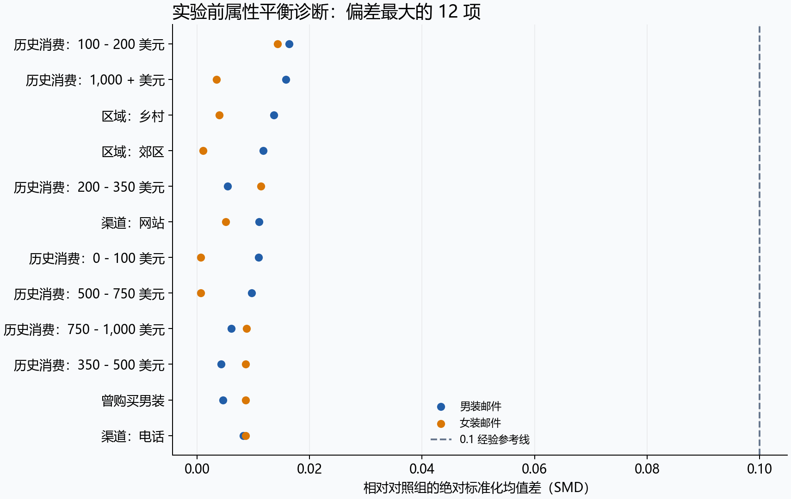
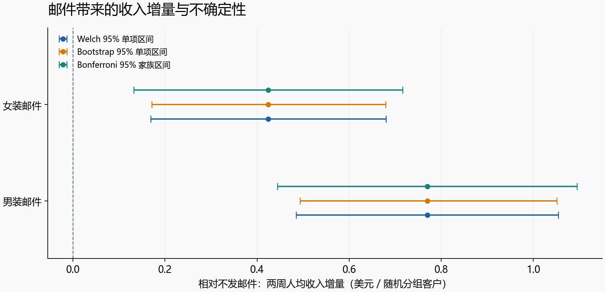
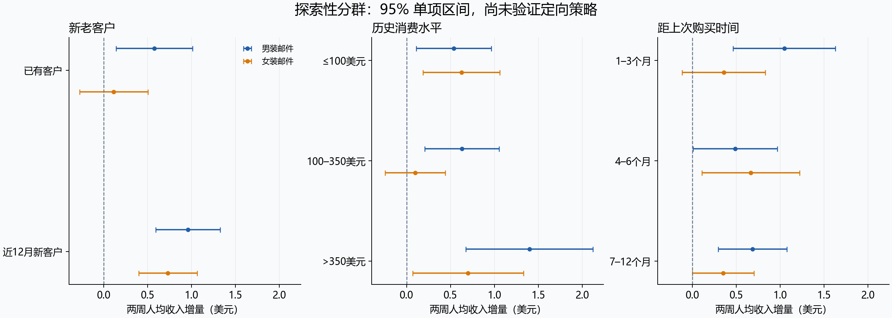

# 营销触达的增量收益评估与人群运营建议

## 1. 业务问题与分析约定

目标是估计邮件营销相对自然购买带来的额外收入，为后续投放实验提供依据。分析以公开数据为基础，未执行真实业务投放。

以随机分组为分析口径（ITT 原则），保留所有客户。邮件主题是男装或女装，不能据此推断客户性别。主指标为两周总消费金额 / 分组客户数；访问率和购买率均按全部客户计算。

本项目在计算结果前将收入指定为主指标，但这是历史数据复盘，不能称为原实验事前注册。未获得原实验实施日志，因果解释依赖作者描述的随机分组、组间无干扰及完整观察等假设。

## 2. 数据质量与指标

来源：[原作者数据说明](https://blog.minethatdata.com/2008/03/minethatdata-e-mail-analytics-and-data.html)。原始文件来源、下载时间与 SHA256 记录在 `data/raw/hillstrom.source.json`，运行参数记录在 `reports/run_manifest.json`。

共 64,000 行，关键字段无缺失，结果字段矛盾为零，排除 0 行。零消费记录 63,422 行全部保留；最高消费 499.00 美元，未经业务依据不删除。完全相同字段记录的后续出现次数为 6,562，因无原始用户 ID 全部保留。`source_row_id` 仅为文件行号。

| 分组 | 客户数 | 访问率 | 购买率 | 两周人均收入（美元） |
| --- | --- | --- | --- | --- |
| 男装邮件 | 21,307 | 18.28% | 1.25% | 1.4226 |
| 不发邮件 | 21,306 | 10.62% | 0.57% | 0.6528 |
| 女装邮件 | 21,387 | 15.14% | 0.88% | 1.0772 |

SQL 与 pandas 分别汇总，客户数、收入、转化、访问与收入方差通过数值一致性检查。数据审计程序遇到缺失、未知类别、空组或矛盾记录会停止，不静默修补。

## 3. 实验可信度诊断

预期三组各占 1/3；卡方分流比例检验 p=0.903693，异常阈值 0.001。当前未触发 SRM。

对实验前连续属性、二元属性及类别独热变量计算相对对照组的标准化均值差，最大绝对 SMD=0.0164。图中 0.1 是经验参考值，不是随机化的证明。平衡结果不用于事后删人或调整分流。

## 4. 总体实验效果

| 相对不发邮件 | 人均收入增量（美元） | 相对提升 | Welch 95% 区间 | Holm校正p值 |
| --- | --- | --- | --- | --- |
| 男装邮件 | 0.7698 | 117.9% | [0.4851, 1.0545] | 2.33e-07 |
| 女装邮件 | 0.4244 | 65.0% | [0.1690, 0.6799] | 0.001129 |

两个收入比较构成主要检验家族：双侧 Welch 检验、家族显著性水平 0.05、Holm 校正。常规区间为单项 95%；另提供 Bonferroni 单项 97.5% 区间，使两个比较的同时覆盖率至少为 95%（基于 Welch 近似）。它更保守，不等同于 Holm 校正区间。

| 邮件 | Bootstrap 95% | Bonferroni单项97.5% |
| --- | --- | --- |
| 男装邮件 | [0.4936, 1.0510] | [0.4443, 1.0954] |
| 女装邮件 | [0.1711, 0.6794] | [0.1323, 0.7166] |

Bootstrap 在各组内以客户为单位有放回抽样，包含所有零消费，重复 5,000 次，固定种子 20260917。收入偏态和稀疏购买下，以百分位区间作为稳健性对照；它不能消除数据缺陷或补回缺失的长期结果。相对提升仅作为描述性点估计，未估计其置信区间；对照均值为零时输出不可用。

| 邮件 | 辅助指标 | 增量（百分点） | 95%区间（百分点） | 未校正p值 |
| --- | --- | --- | --- | --- |
| 男装邮件 | 购买率 | 0.681 | [0.501, 0.864] | 1.52e-13 |
| 男装邮件 | 访问率 | 7.659 | [6.995, 8.323] | 5.72e-112 |
| 女装邮件 | 购买率 | 0.311 | [0.150, 0.475] | 0.000157 |
| 女装邮件 | 访问率 | 4.523 | [3.889, 5.157] | 3.19e-44 |

辅助指标使用 Newcombe 比例差区间与 score 检验，未做确认性多重校正，仅用于机制解释。访问是实验后变量，不能筛出访问客户后再把购买率差解释为总体因果效果。没有订单数，不能把每位购买客户消费额称为客单价。

## 5. 探索性人群分析

事先固定三个维度：新老客户、历史消费 ≤100 / 100–350 / >350 美元、距上次购买 1–3 / 4–6 / 7–12 个月。分界是项目分析约定，不是学习得到的最优切点。

每个维度单独拟合 `spend ~ C(segment) * C(维度)`，以 HC3 稳健协方差对所有交互项做联合 Wald 检验；三个探索性检验再用 Holm 校正。

| 分群维度 | 联合交互检验p值 | 三项Holm校正p值 |
| --- | --- | --- |
| 新老客户 | 0.051584 | 0.154752 |
| 历史消费水平 | 0.059731 | 0.154752 |
| 距上次购买时间 | 0.395774 | 0.395774 |

三项校正后的交互检验均未给出充分证据；不据点估计排序挑选所谓最优人群。

分群图为未经多重校正的单项区间。检验的是“组间效果差异”，不能用某群显著、另一群不显著代替交互检验。联合显著也不能定位具体人群；样本细分后购买事件减少，估计可能不稳定。详表同时提供分组人数与购买人数，不据本次样本计算已验证的精准投放 ROI。

## 6. 收益与推广建议

净收益增量 / 分组客户 = 人均收入增量 × 假设毛利率 − 假设触达成本。默认毛利率情景为 20%, 40%, 60%，触达成本情景为 [0.0, 0.01, 0.05, 0.1, 0.2] 美元。所有参数均为教学假设，可在 `config.json` 修改。

| 邮件 | 假设毛利率 | 点估计可承受成本 | 家族区间下界可承受成本 |
| --- | --- | --- | --- |
| 男装邮件 | 20% | 0.1540 | 0.0889 |
| 男装邮件 | 40% | 0.3079 | 0.1777 |
| 男装邮件 | 60% | 0.4619 | 0.2666 |
| 女装邮件 | 20% | 0.0849 | 0.0265 |
| 女装邮件 | 40% | 0.1698 | 0.0529 |
| 女装邮件 | 60% | 0.2546 | 0.0794 |

上述成本单位为美元 / 客户。下界为负表示无法证明任何非负成本下净收益为正，不代表实际存在负成本。区间仅反映收入估计的不确定性，不包含毛利率、送达率和成本的不确定性，也未覆盖固定实施费用或长期效应。

- **男装邮件：**收入增量有统计证据；在成本和护栏满足条件后开展当前业务验证。
- **女装邮件：**收入增量有统计证据；在成本和护栏满足条件后开展当前业务验证。

统计证据只支持该历史样本。当前业务应先核实单位经济性，再用新样本开展小范围验证；分流异常时必须先排查。

## 7. 下一轮实验设计与样本量

用户级 1∶1∶1 分为不发邮件、男装邮件、女装邮件；分组持久化，按初始分组分析，避免跨组重复触达。实验前确定合格客群、排除规则、收入定义、14 天成熟窗口、可接受的投诉与退订阈值。未成熟客户等待完整窗口，退款计入方式预先锁定。

下表为未来实验设计练习，不能称为原实验事前功效或用来解释原实验 p 值。采用各历史组中最大的收入标准差 17.7542 美元，再做 1.25 倍标准差敏感性分析。采用正态近似，双侧 Bonferroni 单比较 alpha=0.025，目标功效 80%。

每组样本量 = ceil[2 × σ² × (z_(1−α/(2×2)) + z_power)² / MDE²]。三组等额分流，总量为每组的三倍；功效针对单个预设比较，不保证两项同时检出。MDE 是业务值得识别的最小绝对收入增量，不从当前显著结果倒推。

| 人均收入MDE（美元） | 标准差倍数 | 每组客户数 | 三组合计 |
| --- | --- | --- | --- |
| 0.25 | 1.0 | 95,876 | 287,628 |
| 0.5 | 1.0 | 23,969 | 71,907 |
| 1.0 | 1.0 | 5,993 | 17,979 |
| 0.25 | 1.25 | 149,805 | 449,415 |
| 0.5 | 1.25 | 37,452 | 112,356 |
| 1.0 | 1.25 | 9,363 | 28,089 |

下一轮需用近期先导数据更新方差，并验证收入重尾下的功效近似。没有每日合格流量，无法给出真实运行天数；总历时需要覆盖招募时间及最后一批用户的 14 天窗口。固定样本设计下不按每日 p 值提前停止。安全护栏单独监控，触发预设安全规则可暂停，但必须说明停止原因。

若验证人群策略，先在新实验中确认交互假设；再将定向策略与全量策略随机比较并评估同一合格客群的人均净收益，避免用本样本筛人又用本样本评估策略。

## 8. 复现与适用边界

运行方式见 [README](../README.md)，完整数值见 `tables/`，逐步计算见 [分析笔记本](../notebooks/analysis.ipynb)。学习与面试材料见 `docs/`。

没有用户 ID、日级日志、邮件打开与送达日志、实验前同窗收入、成本、毛利率和长期护栏数据；不能做用户跨组排重、时序效应、真实利润或长期留存结论。不将过去一年消费额直接冒充 CUPED 的实验前同窗指标。公开数据年龄限制外推，但不影响练习实验推断和业务决策过程。
